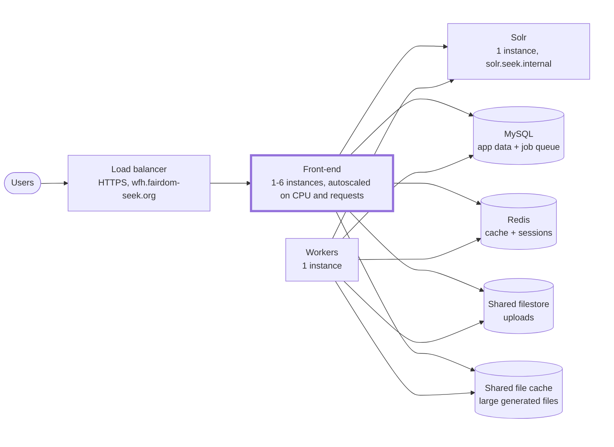
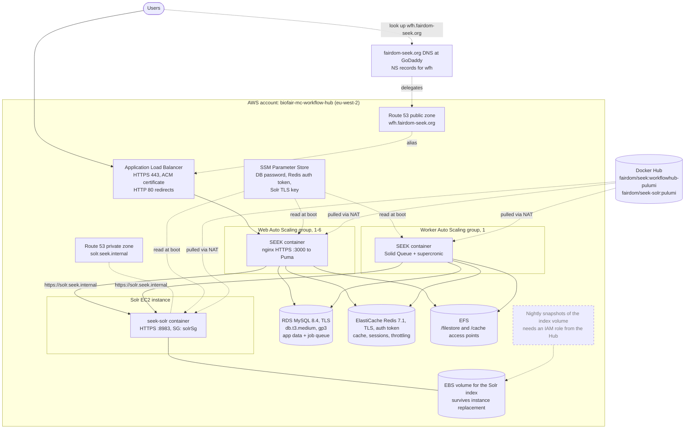
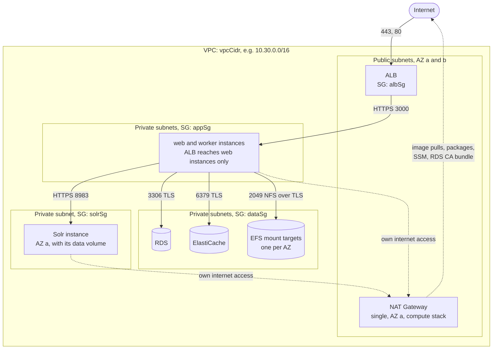

# WorkflowHub on AWS: Pulumi architecture

Diagrams of what the Pulumi project in
[`infra/biofair-mc-workflow-hub/`](../infra/biofair-mc-workflow-hub/) deploys,
and how the project is put together. For deploy steps, see the project's
[README](../infra/biofair-mc-workflow-hub/README.md) and
[`tech-notes.md`](../infra/biofair-mc-workflow-hub/tech-notes.md); for what
each later phase needs, [`pulumi-next-phase.md`](pulumi-next-phase.md); for the
original design, [`SEEK-pulumi-handover.md`](SEEK-pulumi-handover.md).

The diagrams show what the program deploys: phases 1 and 2, and phase 3's
data and compute stacks. The one part still to come is drawn with a dashed
outline: the Solr volume's scheduled snapshots, which wait on an IAM role from
the Hub.
The site's domain is configured but not yet deployed. The rest of phase 4
(backups, CloudWatch logs, higher availability, email delivery) is not
shown.

## Services overview

The services and how they connect. Services with a thick border run as
multiple instances. Every connection is encrypted: HTTPS to and from the load
balancer and to Solr, TLS to MySQL and Redis, and NFS over TLS to EFS.

| Service | Runs as | Instances |
|---|---|---|
| Front-end | SEEK container on EC2, in an Auto Scaling group | 1-6, scaled on CPU, requests per instance and response time (`webCount`, `webCountMax`, `webCpuTarget`, `webRequestTarget`, `webResponseTimeLimit`) |
| Workers | SEEK container on EC2, in an Auto Scaling group | 1 (`workerCount`) |
| Solr | `fairdom/seek-solr` container on a dedicated EC2 instance | 1 |
| MySQL | RDS, managed | single instance |
| Redis | ElastiCache, managed | single node |
| Shared filestore and file cache | EFS, managed, an access point each | mounted by every front-end and worker instance |

## Runtime architecture

How a request reaches SEEK, and which services each part of SEEK depends on.

| docker-compose service | AWS resource |
|---|---|
| `seek` | Web Auto Scaling group (`webGroup`) behind the load balancer |
| `seek_workers` | Worker Auto Scaling group (`workerGroup`), no ingress |
| `db` | RDS MySQL 8.4 (`db`) |
| `redis_store` | ElastiCache Redis replication group (`redis`) |
| `solr` | EC2 instance running `fairdom/seek-solr` (`solrInstance`), index on its own EBS volume (`solrData`) |
| `seek-filestore` volume | An EFS filesystem, through a `/filestore` access point |
| `seek-cache` volume | The same EFS filesystem, through a `/cache` access point |

Each web and worker instance's user data mounts the filestore and file cache
over TLS, reads the database password and Redis auth token from Parameter
Store, fetches the RDS CA bundle, trusts Solr's self-signed certificate,
writes the container environment, and runs the SEEK container. The Solr
instance's user data mounts the index volume, builds Solr's TLS keystore from
the key in Parameter Store, and runs Solr; see
[`tech-notes.md`](../infra/biofair-mc-workflow-hub/tech-notes.md).

## Network and security groups

Two Availability Zones, each with a public and a private subnet. Only the load
balancer and the NAT Gateway sit in public subnets. Arrows point from the side
that opens the connection; responses come back on the same connection.

| Security group | Inbound |
|---|---|
| `albSg` | 443 and 80 from anywhere |
| `appSg` | 3000 from `albSg` |
| `solrSg` | 8983 from `appSg` only |
| `dataSg` | 3306, 6379 and 2049 from `appSg` only |

Solr has a security group of its own, so it is reachable only from the web and
worker instances, and cannot reach the database, Redis or EFS, which it never
uses.

No security group opens port 22. Every instance uses the account's existing
`ssm-instance-profile`, and administrative access is through SSM Session
Manager. The program creates no IAM resources.

## Data and compute stacks

The program is two Pulumi projects, each with a `staging` stack, so the
compute can be destroyed between uses without touching the data. The data
stack's database, filestore and Solr volume are protected by Pulumi's
`protect` when `protectData` is on (off for staging).

```mermaid
flowchart LR
    subgraph data["data/: long-lived"]
        vpc["VPC and subnets<br/>no NAT gateway"]
        sgs["Security groups"]
        rds[("RDS<br/>protect")]
        efs[("EFS<br/>protect")]
        param["DB password parameter"]
        zone["Private DNS zone"]
        solrvol[("Solr data volume<br/>protect")]
        site["Site's public DNS zone<br/>and ACM certificate"]
    end

    subgraph compute["compute/: disposable"]
        nat["NAT gateway, and the private<br/>subnets' default route"]
        alb["Load balancer, listeners,<br/>and the domain's alias record"]
        groups["Web and worker<br/>Auto Scaling groups"]
        solr["Solr instance, DNS record<br/>and TLS certificate"]
        redis[("ElastiCache<br/>and its auth token")]
    end

    data -- "stack reference:<br/>subnet and security group IDs,<br/>DB address, EFS, zone and volume IDs" --> compute
```

## Inside the `Pulumi.yaml` files

Each project is a single Pulumi YAML file in four sections:

| Section | `data/Pulumi.yaml` | `compute/Pulumi.yaml` |
|---|---|---|
| `config` | `environment`, `domainName`, `vpcCidr`, `protectData`, database size and deletion settings, `solrDataSizeGb`, and the `dbPassword` secret | Image tags, web and worker counts and the CPU target, instance types, `redisNodeType`, the SSM instance profile's name |
| `variables` | The `namePrefix` (`biofair-mc-workflow-hub-<environment>`), and the lookup of the subnet for the Solr volume | The data stack's outputs, Solr's DNS name, lookups of the private route tables, the SSM instance profile, the Amazon Linux AMI and the region, and `hostSetup`, the web and worker instances' shared user data |
| `resources` | VPC and security groups; the password parameter, RDS and its parameter group; EFS, its mount targets and access points; the Solr volume; the private DNS zone; the site's public DNS zone, and its ACM certificate with the validation record | The stack reference; the NAT gateway and routes; the generated Redis auth token, its parameter and ElastiCache; the Solr instance, its attachment, DNS record, and TLS key, certificate and key parameter; the load balancer and the domain's alias record; and the web and worker launch templates, Auto Scaling groups and the web scaling policy |
| `outputs` | The IDs, addresses and names the compute stack needs | Site URL, database and Redis endpoints, EFS ID, web and worker group names, Solr's private IP |

Every resource is tagged `Environment` and `ManagedBy: pulumi` through the AWS
provider's `defaultTags` in each stack config, and the instances and their
disks are named after their role (`<prefix>-web`, `-worker`, `-solr`).
